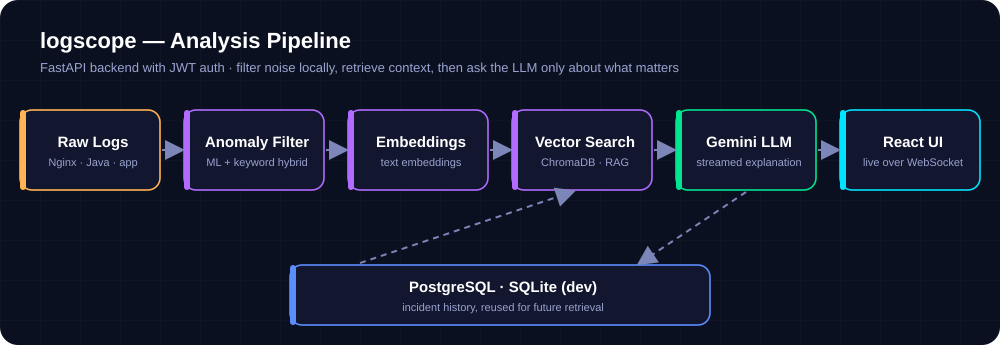
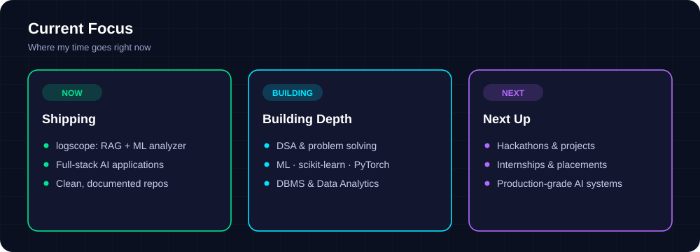

<div align="center">



<br/>


[](https://www.linkedin.com/in/divyanshi-shukla-438417343)
[](https://github.com/Git-Divyanshi-shukla)
[](https://leetcode.com/u/Divyanshi_1427/)


</div>


## 👋 About Me

I'm a **B.Tech Computer Science & Engineering student** (batch 2024–2028) at **Pranveer Singh Institute of Technology, Kanpur**, focused on **Machine Learning, AI systems and full-stack development**. I like projects that go all the way from a model to an API to an interface people can actually use, and I care about the unglamorous parts too: tests, CI, containers and honest documentation of limitations.

```text
  Data ───▶ Models ───▶ APIs ───▶ Interfaces ───▶ Shipping
  Logs      scikit-      FastAPI   React · Vite    Docker Compose
  CSV/SQL   learn ·      JWT       Tailwind ·      GitHub Actions
  APIs      embeddings   WebSocket WebSocket       pytest
```


## 🚀 Featured Project

### 🔍 logscope — AI-Powered Log Analyzer

> Most "AI log analyzer" demos paste an entire log file into an LLM. **logscope** runs a real pipeline instead: a local ML model filters the noise, a vector database retrieves similar past incidents, and Gemini explains what went wrong, why, and how to fix it, streamed live to the UI.

<p align="center">
  
</p>

<table>
<tr>
<td width="50%" valign="top">

**🧠 What it does**

- **Hybrid anomaly detection**: Isolation Forest plus keyword rules (pure ML measurably missed real error lines in testing)
- **RAG over past incidents** with sentence-transformer embeddings and ChromaDB
- **Streamed Gemini explanations** over WebSockets
- **JWT-secured** API with Postgres-backed incident history

</td>
<td width="50%" valign="top">

**🛡️ Built with real-world limits in mind**

- 25 MB upload cap and a 200k-line tail-biased processing cap
- Per-user rate limiting on LLM calls to bound cost
- Recognises ISO, Nginx/Apache and syslog timestamp formats
- Tested against realistic Nginx and Java logs, with **pytest** and **GitHub Actions CI**

</td>
</tr>
</table>

`FastAPI` `JWT` `WebSockets` `scikit-learn` `Isolation Forest` `sentence-transformers` `ChromaDB` `Gemini API` `PostgreSQL` `React` `Vite` `Tailwind` `Docker Compose` `GitHub Actions`

[**View repository →**](https://github.com/Git-Divyanshi-shukla/ai-devops-log-analyzer)


## 🧪 More Work

| Project | What it is | Stack |
| :-- | :-- | :-- |
| 🧠 [**FlyRank ML Internship**](https://github.com/Git-Divyanshi-shukla/flyrank-ml-internship) | Applied search-intelligence work: week-by-week notebooks from research question to data contract, leakage checks, baseline and model | `Python` `Jupyter` `Pandas` `scikit-learn` |
| 🏠 [**House Price Prediction**](https://github.com/Git-Divyanshi-shukla/prodigy-task1-house-price-prediction) | Regression model that predicts house prices | `Python` `Pandas` `Linear Regression` |
| 👥 [**Customer Segmentation**](https://github.com/Git-Divyanshi-shukla/customer-segmentation-kmeans) | K-Means clustering and exploratory analysis of customers | `Python` `Pandas` `K-Means` |
| 🚢 [**Titanic EDA**](https://github.com/Git-Divyanshi-shukla/prodigy-task-2-titanic-eda) | Data cleaning and exploratory data analysis, Prodigy InfoTech Data Science Task 2 | `Python` `Pandas` |
| 🌍 [**World Population Visualization**](https://github.com/Git-Divyanshi-shukla/prodigy-ds-task-01-world-population) | Population data visualisation, Prodigy InfoTech Data Science Task 1 | `Python` `Matplotlib` `Seaborn` |
| 🌦️ [**Weather Report**](https://github.com/Git-Divyanshi-shukla/weather-report) | API-driven weather web app | `HTML` `CSS` `JavaScript` |


## 🛠️ Tech Stack

<table>
<tr>
<td width="150"><b>💻 Languages</b></td>
<td>


</td>
</tr>
<tr>
<td><b>🤖 ML &amp; AI</b></td>
<td>


</td>
</tr>
<tr>
<td><b>⚙️ Backend &amp; Data</b></td>
<td>


</td>
</tr>
<tr>
<td><b>🎨 Frontend</b></td>
<td>


</td>
</tr>
<tr>
<td><b>🧰 DevOps &amp; Tools</b></td>
<td>


</td>
</tr>
</table>


## 🧭 Current Focus

<p align="center">
  
</p>


## 🧮 Problem Solving

[](https://leetcode.com/u/Divyanshi_1427/)


## 📊 GitHub Stats

<p align="center">
  
  
</p>

<p align="center">
  
</p>

## 🧊 3D Contributions

<p align="center">
  
</p>


## 🤝 Let's Connect

I'm looking for **internship opportunities** in **ML / AI, software engineering and data roles**. If you're building something interesting, I'd love to hear about it.

<p align="center">
  <a href="https://www.linkedin.com/in/divyanshi-shukla-438417343"></a>
  <a href="https://github.com/Git-Divyanshi-shukla"></a>
</p>


